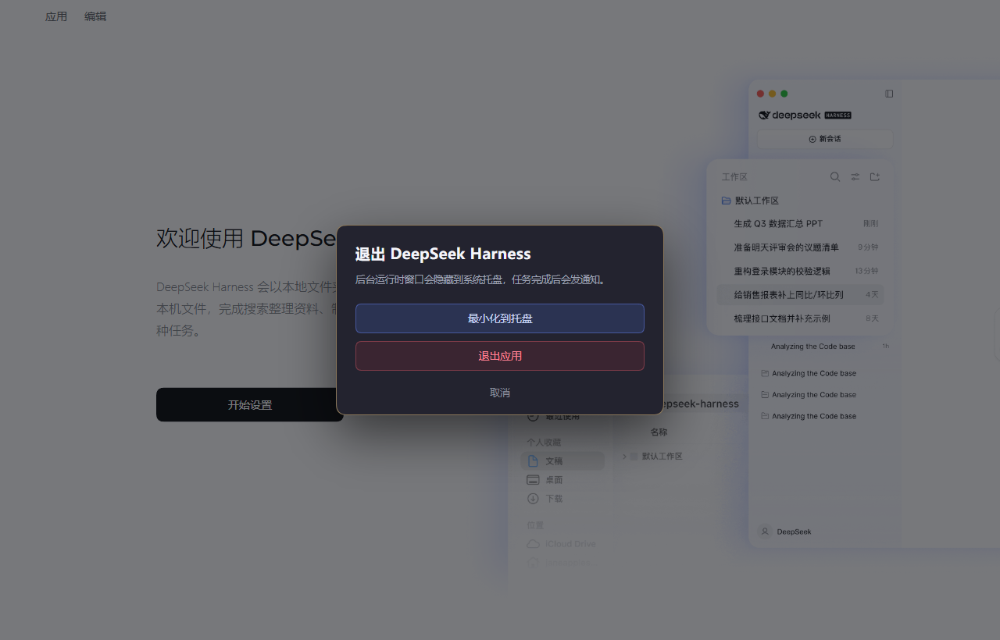

# dsh-close-dialog

给 **DeepSeek Harness 桌面端**（Electron 版）的窗口 × 按钮补一个三档关闭对话框：**最小化到托盘 / 退出应用 / 取消**。暗色卡片、金色描边、无系统提示音，键盘可操作。

交互与视觉参照 [EAC-Desktop](https://github.com/Ebony-Vinyl/EAC-Desktop) 的关闭提示。

> DeepSeek Harness 官方桌面端点 × 时默认直接隐藏到托盘（首次会弹一次系统提示）。本工具把它换成一次明确的三选一。



## 特性

- 三档选择：最小化到托盘 / 退出应用 / 取消
- 卡片画在窗口页面内，不是系统原生对话框 —— 无 Windows 提示音、样式可控
- **Tab** 在按钮间循环，**Enter** 触发聚焦按钮（默认「最小化到托盘」），**Esc** 取消
- 不修改安装包、不修改 `app.asar`，全部通过运行时注入完成
- 「退出应用」走官方退出流程，官方自己的退出确认（例如有任务在跑时）依然有效

## 环境要求

- Windows 10 / 11
- [Node.js](https://nodejs.org/) 18 或更高（只用来跑启动器，客户端本身不需要）
- 官方 DeepSeek Harness 桌面端（Electron 版）。已验证 **0.2.2-rc.1**

## 安装

### 方式一：脚本安装（推荐）

```powershell
powershell -ExecutionPolicy Bypass -File .\install.ps1 -ExePath "C:\Path\To\DeepSeek Harness.exe"
```

脚本会：

1. 把 `hook-inject.js`、`launch.js`、`run-hidden.vbs` 复制到 `%LOCALAPPDATA%\dsh-close-dialog`
2. 把桌面上的 `DeepSeek Harness.lnk` 备份为 `DeepSeek Harness.lnk.bak`，并改成经 `run-hidden.vbs` 启动

常用参数：`-NoShortcut`（不动桌面快捷方式）、`-DryRun`（只打印将要做什么）、`-Dest <目录>`（换安装位置）。

### 方式二：手动

1. 把 `hook-inject.js`、`launch.js`、`run-hidden.vbs` 放进同一个目录，例如 `%LOCALAPPDATA%\dsh-close-dialog`
2. 打开桌面（或开始菜单）上 DeepSeek Harness 的快捷方式 → 属性：
   - **目标**：`C:\Windows\System32\wscript.exe`
   - **参数**：`"<目录>\run-hidden.vbs"`（注意引号）
   - **图标**：沿用官方 exe 的第 0 个图标
3. 如果客户端不在默认位置，在同目录建一个 `exe-path.txt`，写一行客户端 exe 的绝对路径
4. 双击快捷方式启动

> **注意**：先退出正在运行的客户端再启动。客户端有单实例锁，已有实例时新进程会直接退出，注入不会生效。

### 为什么快捷方式指向 wscript.exe

直接双击 `.cmd` 或自编译的未签名 `.exe` 时，Windows 会弹「打开文件 - 安全警告（无法验证发布者）」。把目标设成**已签名的系统程序** `wscript.exe`，再由 VBS 用 `WScript.Shell.Exec`（CreateProcess 语义）启动 node，就绕开了这条 ShellExecute 提示；wscript 本身没有控制台，所以也不会闪黑窗。

## 配置

| 文件（与本脚本同目录） | 作用 |
| --- | --- |
| `exe-path.txt` | 一行客户端 exe 绝对路径；不写则自动探测 |
| `hook.disabled` | 建这个空文件 → 不注入，按官方默认行为启动 |
| `native-dialog` | 建这个空文件 → 卡片换成系统原生对话框（无图标，因此也不响提示音） |
| `hook.log` | 启动与注入日志，`ok:true` 表示注入成功 |
| `launcher.log` | 只在找不到 node 或启动失败时写入 |

## 原理

官方主进程（`resources\app.asar` → `lib/main.js`）里点 × 的路径是：

```js
window.on("close", (event) => {
  event.preventDefault();
  const hide = () => hideMainWindow(window);
  if (backgroundNotice === void 0) hide();
  else backgroundNotice.close(hide);   // 首次一次性提示 → 确认后 hide()
});
```

也就是说：点 × 永远不会真的关掉窗口，只会 `hide()`。本工具据此接管：

1. `launch.js` 以 `--inspect=<随机本地端口>` 启动官方 exe
2. 通过 CDP（`/json/list` + WebSocket + `Runtime.evaluate`）把 `hook-inject.js` 注入主进程，然后自己退出
3. 钩子在主进程里给 `BrowserWindow.prototype.hide` 包一层：只拦截「由 close 流程引起的隐藏」，命中时先问，再决定隐藏 / 退出 / 什么都不做

对话框本身通过 `webContents.executeJavaScript` 在主窗口页面里执行：遮罩、卡片、按钮都用 DOM API + CSSOM 逐条赋值创建（不注入 `<style>` 字符串，避免撞上页面 CSP），返回一个 Promise，用户选择后 `resolve('tray' | 'quit' | 'cancel')`。

注入时还会预置官方的 `<userData>\background-close-confirmed` 标记，避免官方的首次提示和本对话框叠在一起。

## 为什么不是插件

DeepSeek Harness 的插件跑在内核 node 进程里（`ELECTRON_RUN_AS_NODE`），拿不到 Electron 的 `app` / `BrowserWindow` / `Tray`；渲染层暴露的桌面桥接也没有隐藏窗口或托盘接口；主进程也没有用于拦截关闭的扩展点。窗口隐藏与托盘只有 Electron 主进程能做，所以只能用运行时注入。

## 卸载

1. 退出客户端
2. 删除安装目录
3. 把桌面快捷方式改回官方 exe（或直接用 `DeepSeek Harness.lnk.bak` 还原）
4. 想恢复官方的首次提示：删掉 `%APPDATA%\@deepseek-ai\dsh-desktop\background-close-confirmed`

## 已知限制

- 只对**经 `run-hidden.vbs` 启动**的实例生效；直接双击官方 exe 起的是原样行为
- 依赖 Electron 的 `--inspect` 开关（fuse `EnableNodeCliInspectArguments`）。官方若关掉它，本方案失效
- 注入期间进程带着 `--inspect`：端口只监听 `127.0.0.1` 且随机，但进程存活期间本机程序可以连上它
- 官方若改变关闭实现（不再是「先 hide」），卡片不会出现，需要更新 `hook-inject.js`
- 卡片的样式依赖当前页面 DOM 结构（画在 `document.body` 上）；页面大改版时可能需要微调

## 许可

[MIT](LICENSE)

## 相关

- [EAC-Desktop](https://github.com/Ebony-Vinyl/EAC-Desktop) —— 关闭提示的交互与视觉参考
